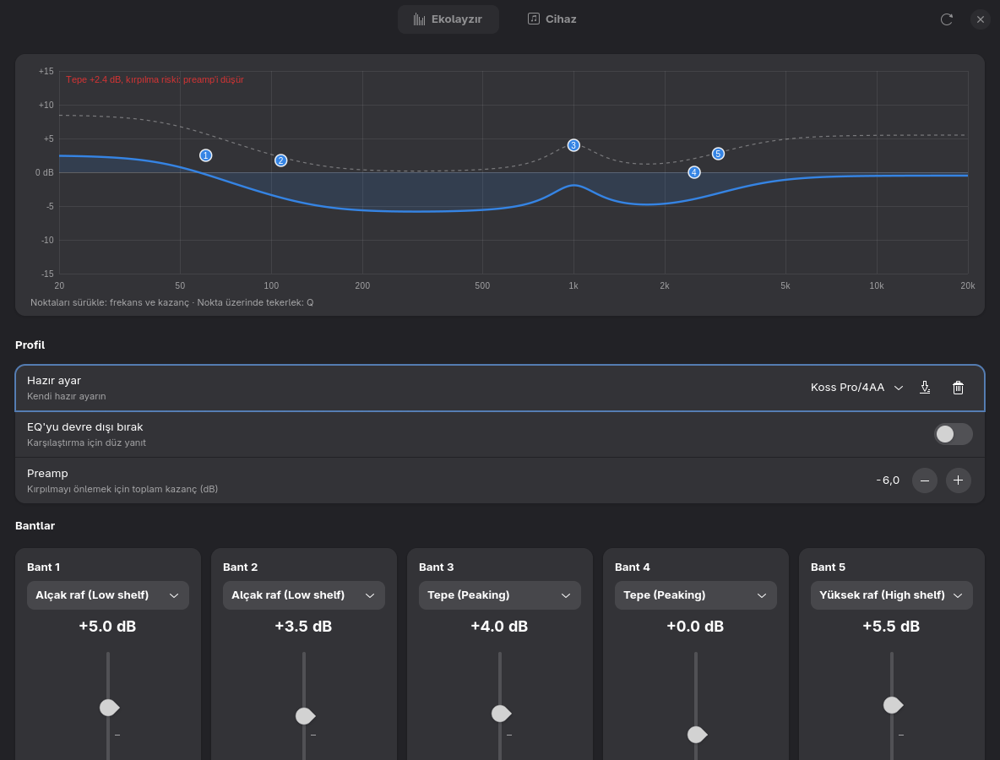
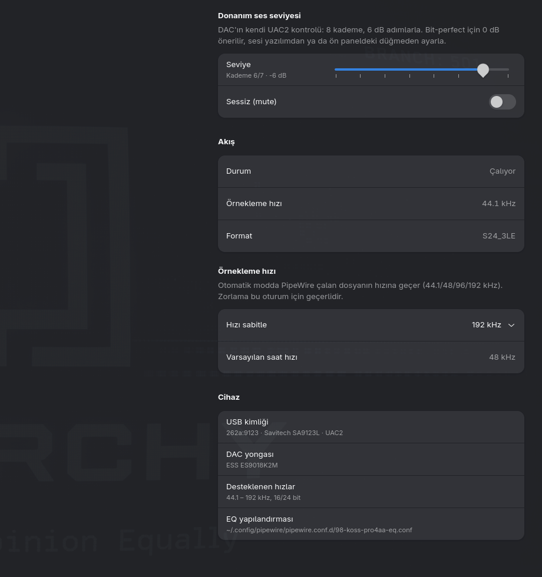

# AIYIMA DAC-A5 Pro paneli

Arch/Omarchy için GTK4 + libadwaita ince ayar arayüzü. Bağımlılıklar: `python-gobject`, `gtk4`, `libadwaita`, `pipewire`, `alsa-utils` (hepsi kurulu).

```
./install.sh            # ~/.local/bin ve uygulama menüsüne ekler
aiyima-dac-panel        # ya da menüden "AIYIMA DAC-A5 Pro"
aiyima-dac-panel --cihaz  # doğrudan Cihaz sekmesiyle açar
```

## Ne yapar
- **Ekolayzır:** `~/.config/pipewire/pipewire.conf.d/98-koss-pro4aa-eq.conf` filter-chain'ini canlı düzenler
  (`pw-cli set-param`, yeniden başlatma yok). Eğri üzerindeki noktalar sürüklenebilir, tekerlek Q'yu değiştirir.
  Tepe 0 dB'i aşarsa kırpılma uyarısı verir. "Kalıcı kaydet" dosyayı yazar ve `.bak-<tarih>` yedeği bırakır.
  Filtre tipi değişikliği PipeWire yeniden başlatılınca devreye girer (panel onay ister).
- **Hazır ayarlar:** 10 yerleşik ayar (`aiyima_panel/presets.py`, preamp otomatik) + kendi ayarların `~/.config/aiyima-dac-panel/presets/*.json`. Listeden seçmek ayarı canlı uygular.
- **Cihaz:** UAC2 donanım seviyesi (0–7, 6 dB adım) ve mute, çalan akışın hızı/formatı,
  `clock.force-rate` ile örnekleme hızı sabitleme (oturumluk).

Cihazın HID kanalına hiçbir şey yazılmaz. Ayrıntılar: [KESIF.md](KESIF.md).

## Ekran görüntüleri



